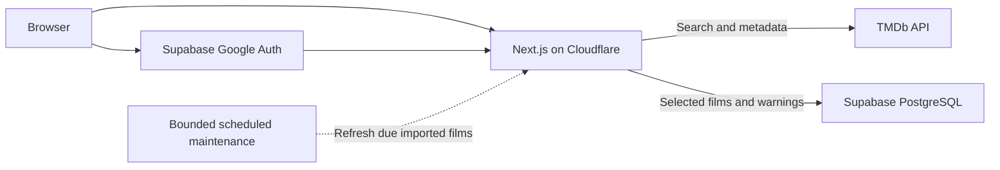

# Triggerboxd movie data architecture

Reviewed: 2026-10-12. Status: recommended architecture; documentation only. Licensing confirmation and public release checks remain pending. This document does not authorize implementation or deployment.

## Decision

Use a hybrid architecture: server-side TMDb search, on-demand persistence of selected films, and independent community warnings in Supabase. Do not mirror the entire TMDb catalogue. Keep Next.js, Cloudflare Workers/OpenNext and Supabase; introduce no Java service, Redis, Kafka, queues or Spring Batch.

Repository inspection found reusable movie search/import routes, TMDb gateway, Google authentication, contribution RPCs, RLS, quota/idempotency controls and Indian certification fetching. Stored metadata needs a freshness/retention policy. Certification currently causes an upstream fetch per movie-page request. No application changes were made during this review.

## Alternatives

| Approach | Advantages | Disadvantages | Recommendation |
| --- | --- | --- | --- |
| Live TMDb fetching | Broad discovery, little catalogue maintenance | Upstream latency/outages, repeated requests | Use for search |
| Full local catalogue | Local search and runtime independence | Bulk import, multilingual indexing, storage, synchronization and licensing overhead | Defer |
| Hybrid | Broad discovery, durable warning pages, imports only useful films | Freshness and failure handling required | Choose |

Letterboxd confirms a 30-hour metadata-update window and TMDb-ID import shortcut. Its internal synchronization implementation is not publicly established. Do not copy a presumed internal architecture.

## Architecture

- Search through server routes; keep the TMDb token private.
- Enrich results with existing local movie IDs and warning availability.
- Existing film pages read local metadata and independent community assessments.
- First-open importing validates the selected TMDb movie ID and fetches authoritative details. Enforce uniqueness and idempotency.
- Recommended improvement: public reading should not require authentication even for a previously unimported film. A bounded, rate-limited public resolve/import operation can call a privileged import internally. Current new-film imports require login; changing this needs implementation and security review.
- Google authentication remains required to contribute.
- During upstream outages, existing warning pages remain readable; search failures or local-only fallback results must be explicit.
- Metadata refresh must never overwrite community warnings.

## New and missing films

Live search makes newly added TMDb films searchable when TMDb exposes them, without manual catalogue maintenance. No exact indexing-delay promise.

Optional recent-release shelves use `/discover/movie` with date ranges and separate original-language filters for `ml`, `ta` and `hi`, plus international discovery. `language` selects translation; `with_original_language` filters original language. `region=IN` concerns regional releases and is not an Indian-production filter.

Provide missing-film guidance linking to TMDb contribution instructions. Support a TMDb movie ID or validated movie URL, fetch details server-side and reuse the import flow. Reject nonexistent IDs and unsupported media. Do not maintain a second manual catalogue at launch.

Daily ID exports contain IDs and limited attributes, not full metadata. They are not needed for this MVP.

## PostgreSQL schema

Extend existing tables rather than replace them.

| Table | Fields and constraints |
| --- | --- |
| `movies` | Internal UUID; unique `tmdb_id`; title/original title; release date; language; production countries; poster path; optional synopsis; visibility; fetched/refresh timestamps |
| `warning_categories` | Slug, label, severity guidance, display order |
| `profiles` | Supabase user ID, display name, created timestamp |
| `contributions` | ID, movie/user foreign keys, watched confirmation, revision, visibility, timestamps; unique user/movie |
| `category_ratings` | Contribution/category foreign keys, severity 0–3; composite primary key |
| `movie_certifications` (proposed) | Movie ID, country, label, release type/date, fetched timestamp |
| `verification_votes` (deferred) | Rating target, target revision, voter, agree/disagree, timestamp; unique voter/target/revision |

Persist the small metadata snapshot needed for stable pages. Store poster paths, not image binaries. Fetch unused optional metadata only when a product feature requires it. Certification records should retain release context instead of implying one universal certificate.

Missing category rows mean Unknown; severity 0 is an explicit None. Independent assessments already provide corroboration. Verification clicks are not proof. If added later, prohibit self-voting and invalidate votes when the target assessment changes.

Retain owner-only mutation, account-status checks and public aggregate reads. Do not expose private accounts, privileged credentials or arbitrary metadata-writing endpoints.

## TMDb endpoints

| Endpoint | Use |
| --- | --- |
| `/search/movie` | Title search |
| `/movie/{id}` | Import and authoritative refresh |
| `/movie/{id}/release_dates` | Country/release-specific certifications |
| `/configuration` | Image host and supported sizes |
| `/discover/movie` | Optional release shelves |
| `/movie/changes` | Optional changed-ID synchronization |
| `/movie/{id}/changes` | Optional field-level change inspection |

Use `append_to_response=release_dates` with details where supported to combine requests. Certifications are separate from viewer warnings and do not provide detailed censor cuts.

## Refresh and scheduling

Scheduled synchronization is unnecessary for new films to become searchable. Bounded maintenance is useful for stored metadata freshness and permitted retention.

Proposed intervals, subject to the applicable licence:

- Search-response cache: approximately five minutes.
- Certifications: daily refresh.
- Recent releases and frequently visited imported films: daily refresh.
- Older active imported films: weekly refresh.
- Inactive snapshots: refresh or expire before the permitted retention deadline.
- Clean expired quota/idempotency records periodically.

Start with due timestamps for the imported catalogue. Add global change tracking only when it saves calls. Intersect changed IDs with locally stored IDs; do not fetch every changed film worldwide. A global changes feed may cost more than refreshing a tiny local catalogue.

Change lists default to 24 hours and support up to 14-day windows. Keep a checkpoint with overlap and bounded pagination; do not advance past incomplete work. After a long outage, use bounded date windows or a local full refresh rather than assuming one request covers everything.

Use Cloudflare scheduled handlers when necessary. Spring Boot `@Scheduled` would need an additional runtime; do not introduce Spring for this task. An already-running Java service could schedule work, but this project has no demonstrated need for one.

Handle timeouts and 429 responses, bounded retries with jitter, modest concurrency and per-run budgets. Preserve usable metadata on transient failures within allowed retention. TMDb's approximate 40 requests/second upper limit can change; it is not a guaranteed quota.

## API usage and infrastructure

Illustrative daily workload, not a measurement:

| Activity | Requests |
| --- | ---: |
| 500 actual search-page requests | 500 before caching |
| 50 new imports with appended certifications | 50 |
| 100 due refreshes | 100 |
| Three discovery shelves, one page each | 3 |
| Total | Approximately 653, excluding retries |

Typing can produce multiple searches despite debouncing. Current uncached certifications add approximately one upstream request per movie-page load. Cache only public metadata; never cache sessions or user-specific contribution responses across users.

Cloudflare Free currently lists 100,000 requests/day and 10 ms CPU per invocation. Benchmark actual deployed OpenNext SSR: request volume alone does not prove free-tier compatibility. Supabase Free includes a 500 MB database and 5 GB egress; indexes, authentication and operational records consume capacity. Keep posters outside Supabase storage. Recheck limits at deployment; free operation is conditional.

## Licensing and attribution

Confirmed by the official TMDb FAQ:

- Non-commercial API use is free with required attribution.
- Commercial use requires contacting TMDb for licensing.
- The FAQ's commercial definition concerns a project's primary purpose of generating revenue for its owner.
- Use an approved TMDb logo and required notice prominently in About/Credits:

> This product uses the TMDB API but is not endorsed or certified by TMDB.

- Logo placement must not imply endorsement or dominate the product identity.
- TMDb does not claim ownership of all supplied images/data. API access does not confer blanket poster ownership.

The indexed official API terms contain a restriction against caching information longer than six months. Full direct retrieval was blocked by robots rules during review, so the complete current agreement and the account's accepted terms were not verified. Confirm permitted storage, refresh, removal and caching with TMDb before treating indefinite persistence as allowed. A periodic refresh is a proposed technical policy, not a confirmed interpretation of the licence.

No ads today does not automatically settle licensing for a startup intended to monetize later. Describe Triggerboxd accurately to TMDb; reassess before advertising, subscriptions or other monetization. Developer API access must not be treated as confirmed commercial permission.

## Dependency-ordered implementation plan

1. Confirm licensing, attribution and metadata-retention rules.
2. Reuse existing services; finish browser verification of contribution publishing, editing and deleting.
3. Make first-open reading public through abuse-limited imports, with security tests.
4. Add TMDb-ID import and missing-film guidance.
5. Cache permitted public metadata and combine details/certifications.
6. Add safe refresh timestamps, expiry and failure handling.
7. Add optional language-specific release shelves.
8. Add bounded scheduled maintenance; defer global change tracking.
9. Validate concurrent imports/submissions, Unknown handling, missing certifications, outages, 429 responses, access isolation and deployed CPU limits.
10. Add verification votes and broader moderation only when real usage demonstrates a need.

## Sources

- [Letterboxd film data](https://letterboxd.com/about/film-data/)
- [TMDb FAQ and attribution](https://developer.themoviedb.org/docs/faq)
- [TMDb API terms — full retrieval unverified](https://www.themoviedb.org/api-terms-of-use?language=en-CA)
- [TMDb discovery](https://developer.themoviedb.org/reference/discover-movie)
- [TMDb release dates](https://developer.themoviedb.org/reference/movie-release-dates)
- [TMDb append to response](https://developer.themoviedb.org/docs/append-to-response)
- [TMDb change tracking](https://developer.themoviedb.org/docs/tracking-content-changes)
- [TMDb daily ID exports](https://developer.themoviedb.org/docs/daily-id-exports)
- [TMDb rate limits](https://developer.themoviedb.org/docs/rate-limiting)
- [Cloudflare pricing](https://developers.cloudflare.com/workers/platform/pricing/)
- [Supabase billing](https://supabase.com/docs/guides/platform/billing-on-supabase)

For a solo developer, the hybrid approach concentrates effort on reliable community warnings rather than running a second movie database.
